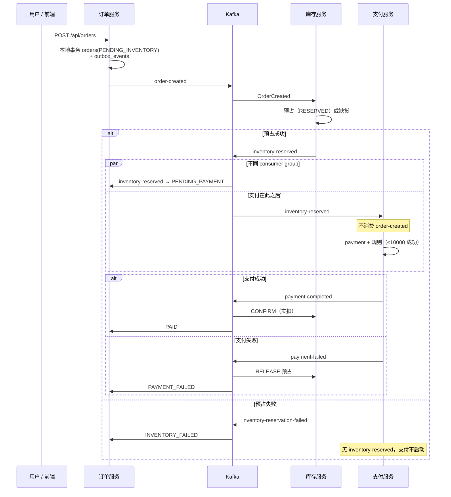
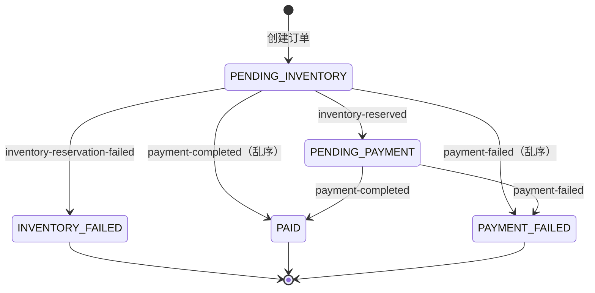

# 订单支付演示（Order Payment Demo）

事件驱动示例：Angular + Spring Boot 微服务 + PostgreSQL + Kafka。涵盖 JWT 认证、**事务性 Outbox**、库存 **Saga**（预占 → 支付 → 确认或释放）、幂等消费与死信主题（DLT）。

**技术栈：** Java 25、Spring Boot 4.1.1、Angular 22.1.x、PostgreSQL 17、Kafka 4.1.0。

## 快速开始

在仓库根目录执行：

```bash
docker compose -f docker/docker-compose.yml up -d --build
```

打开 **http://localhost:4200**，注册、登录并创建订单。

若从缺少 `inventory_db` 的旧版本升级，需先重置卷一次：`docker compose -f docker/docker-compose.yml down --volumes`，再重新 `up`。

## 端口

| 组件 | 地址 |
| --- | --- |
| 前端 | http://localhost:4200 |
| 订单服务（order-service） | http://localhost:8080 |
| 支付服务（payment-service） | http://localhost:8081 |
| 通知服务（notification-service） | http://localhost:8082 |
| 库存服务（inventory-service） | http://localhost:8083 |
| PostgreSQL | `localhost:5432`（用户/密码 `postgres`） |
| Kafka | `localhost:9092` |

各 Spring Boot 服务健康检查：`http://localhost:<端口>/actuator/health`。

## 仓库结构

```text
frontend/              Angular 前端（见 frontend/README.md）
order-service/         REST、JWT、下单与 Outbox（见 order-service/README.md）
inventory-service/     Saga 库存预占步骤（见 inventory-service/README.md）
payment-service/       预占成功后再支付（见 payment-service/README.md）
notification-service/  日志模拟邮件通知（见 notification-service/README.md）
docker/                Compose 与数据库初始化（见 docker/README.md）
docs/                  源码导读与运维手册（见 docs/README.md）
```

## 架构与 Saga

**各服务职责、端口、Kafka 入出站** 见对应子项目 README：

| 服务 | 文档 |
| --- | --- |
| order-service | [order-service/README.md](order-service/README.md) |
| inventory-service | [inventory-service/README.md](inventory-service/README.md) |
| payment-service | [payment-service/README.md](payment-service/README.md) |
| notification-service | [notification-service/README.md](notification-service/README.md) |
| frontend | [frontend/README.md](frontend/README.md) |
| Compose 拓扑与端口 | [docker/README.md](docker/README.md) |

### 组件一览

| 服务 | 端口 | 数据库 | 职责（摘要） |
| --- | --- | --- | --- |
| **order-service** | 8080 | `order_db` | REST + JWT；Outbox 发 `order-created`；消费库存/支付结果 |
| **inventory-service** | 8083 | `inventory_db` | 预占；发 `inventory-reserved` / `inventory-reservation-failed`；支付后确认或释放 |
| **payment-service** | 8081 | `payment_db` | **仅**消费 `inventory-reserved`；模拟支付 |
| **notification-service** | 8082 | 无 | 消费支付结果，日志模拟邮件 |

原则：**一服务一库**，跨服务只通过 Kafka JSON 事件协作；各服务自有 `event/*Event.java`，字段一致即可互通。

### 部署拓扑（简图）

```text
浏览器 → Angular (4200) --JWT/HTTP--> 订单服务 (8080) → order_db
                                          │
                                          ▼ order-created
                                        Kafka
                                          │
                                          ▼
                               库存服务 (8083) → inventory_db
                                          │
                    inventory-reserved / inventory-reservation-failed
                          ┌───────────────┴───────────────┐
                          ▼                               ▼
                 支付服务 (8081)                    订单服务（状态）
                          │ payment-completed / payment-failed
                          ├──────────────┬──────────────────┐
                          ▼              ▼                  ▼
                 库存（确认/释放）      订单            通知服务 (8082)
```

### 推荐业务顺序：先占库存，再支付

采用 **预占 → 支付 → 确认 / 释放**（Reserve → Pay → Confirm / Release）。`payment-service` **不**订阅 `order-created`，只处理 `inventory-reserved`，避免「付了款没货」。



**notification-service** 与订单、库存服务并行消费 `payment-completed` / `payment-failed`（图中未画出）。

#### 步骤与本地事务

| 步骤 | 事务所在库 | 主要 Kafka 事件 |
| --- | --- | --- |
| 下单 | `order_db`（订单 + Outbox） | `order-created` |
| 预占 | `inventory_db` | `inventory-reserved` / `inventory-reservation-failed` |
| 支付 | `payment_db` | `payment-completed` / `payment-failed` |
| 补偿 | `inventory_db`（释放或确认） | 消费支付结果（无单独 release topic） |

### 订单状态（order-service）

明细与实现类见 [order-service/README.md#订单状态](order-service/README.md#订单状态)。

| 状态 | 含义 |
| --- | --- |
| `PENDING_INVENTORY` | 已下单，等待预占 |
| `PENDING_PAYMENT` | 已预占，等待支付 |
| `INVENTORY_FAILED` | 缺货等，终态（不会支付） |
| `PAID` | 支付成功 |
| `PAYMENT_FAILED` | 支付失败 |



### Kafka 主题

| 主题 | 生产者 | 主要消费者 |
| --- | --- | --- |
| `order-created` | order-service | inventory-service |
| `inventory-reserved` | inventory-service | payment-service、order-service |
| `inventory-reservation-failed` | inventory-service | order-service |
| `payment-completed` | payment-service | inventory、order、notification |
| `payment-failed` | payment-service | inventory、order、notification |
| `order-created.DLT` | Kafka 错误处理 | 运维排查 |
| `inventory-reserved.DLT` | Kafka 错误处理 | 运维排查 |

消息 **key** 一般为 `orderId`（单分区 demo 下保证同订单有序）。

### 分布式事务：本项目的含义

不使用跨库 **2PC/XA**，而是 **Saga + 最终一致**：

1. 每一步只提交本服务 PostgreSQL 事务。
2. 步骤间用 Kafka 衔接；失败用补偿（如支付失败 → 库存 RELEASE）。
3. **至少一次**投递 + `processed_events`（inventory/payment）与订单状态机幂等。

### 事务性 Outbox（下单）

说明见 [order-service/README.md#事务性-outbox下单](order-service/README.md#事务性-outbox下单)。Outbox 专用序列图与 SQL 见 [docs/runbook.md#outbox-表](docs/runbook.md#outbox-表)。

### 演示规则与故障注入

| 场景 | 用法 |
| --- | --- |
| 默认库存 | 首次出现的 `productName` 自动建 SKU，可售 **100** |
| 缺货 | 商品名 **`OUT_OF_STOCK`** → `INVENTORY_FAILED`，不支付 |
| 支付限额 | 订单总金额 **≤ 10000** 成功，否则 `PAYMENT_FAILED` |
| 库存消费 DLT | 商品名 **`KAFKA_FAIL`** 于 `order-created` 消费失败 → `order-created.DLT`（重试 3 次，间隔 500ms） |
| 支付消费 DLT | 对 **`inventory-reserved`** 消息同样可用 `KAFKA_FAIL` 钩子；UI 下单会在库存阶段失败，需测试或手工发消息验证 `inventory-reserved.DLT` |

## 文档

| 文档 | 内容 |
| --- | --- |
| **本 README** | 快速上手、架构与 Saga |
| **[docs/README.md](docs/README.md)** | 文档索引 |
| **各服务 README**（`*/README.md`） | 单服务职责、端口、Kafka 入出站 |
| **[docs/code-guide.md](docs/code-guide.md)** | 阅读顺序、类对照、模式与代码 |
| **[docs/runbook.md](docs/runbook.md)** | 本地/Docker 运行、Kafka/Postgres 运维、测试 |

`src/main` 内源码注释（Java 与 `application.yml`）为中文，与 **code-guide** 对应。

## 测试

集成测试依赖 Testcontainers，需本机 Docker 已运行。

```bash
cd order-service && ./mvnw test
cd inventory-service && ./mvnw test
cd payment-service && ./mvnw test
cd notification-service && ./mvnw test
cd frontend && npm test -- --watch=false
```

不启动完整 Compose 时的逐步本地运行方式见 [docs/runbook.md](docs/runbook.md)。
