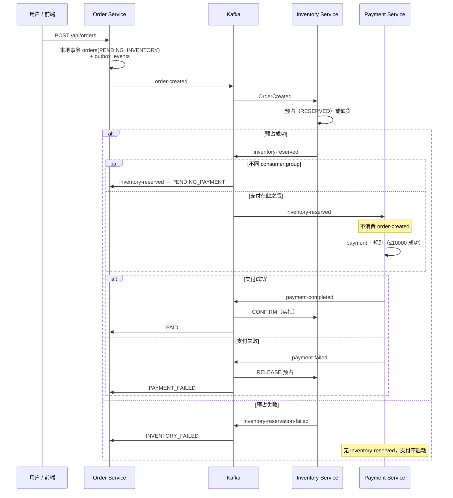
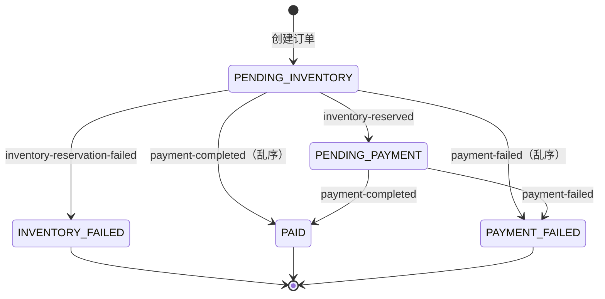

# 架构与 Saga

## 组件职责

| 服务 | 端口 | 数据库 | 职责 |
| --- | --- | --- | --- |
| **order-service** | 8080 | `order_db` | REST + JWT；下单与 Outbox 发 `order-created`；消费库存/支付结果更新订单 |
| **inventory-service** | 8083 | `inventory_db` | 消费 `order-created` 预占；发 `inventory-reserved` / `inventory-reservation-failed`；支付后确认或释放 |
| **payment-service** | 8081 | `payment_db` | **仅**消费 `inventory-reserved`；模拟支付；发 `payment-completed` / `payment-failed` |
| **notification-service** | 8082 | 无 | 消费支付结果，日志模拟邮件 |

原则：**一服务一库**，跨服务只通过 Kafka JSON 事件协作；各服务自有 `event/*Event.java`，字段一致即可互通。

## 部署拓扑（简图）

```text
Browser → Angular (4200) --JWT/HTTP--> Order Service (8080) → order_db
                                          │
                                          ▼ order-created
                                        Kafka
                                          │
                                          ▼
                               Inventory Service (8083) → inventory_db
                                          │
                    inventory-reserved / inventory-reservation-failed
                          ┌───────────────┴───────────────┐
                          ▼                               ▼
                 Payment Service (8081)            Order Service（状态）
                          │ payment-completed / payment-failed
                          ├──────────────┬──────────────────┐
                          ▼              ▼                  ▼
                 Inventory（确认/释放）  Order            Notification (8082)
```

## 推荐业务顺序：先占库存，再支付

采用 **Reserve → Pay → Confirm / Release**。`payment-service` **不**订阅 `order-created`，只处理 `inventory-reserved`，避免「付了款没货」。



**notification-service** 与 Order / Inventory 并行消费 `payment-completed` / `payment-failed`（图中未画出）。

### 步骤与本地事务

| 步骤 | 事务所在库 | 主要 Kafka 事件 |
| --- | --- | --- |
| 下单 | `order_db`（订单 + Outbox） | `order-created` |
| 预占 | `inventory_db` | `inventory-reserved` / `inventory-reservation-failed` |
| 支付 | `payment_db` | `payment-completed` / `payment-failed` |
| 补偿 | `inventory_db`（释放或确认） | 消费支付结果（无单独 release topic） |

## 订单状态（order-service）

| 状态 | 含义 |
| --- | --- |
| `PENDING_INVENTORY` | 已下单，等待预占 |
| `PENDING_PAYMENT` | 已预占，等待支付 |
| `INVENTORY_FAILED` | 缺货等，终态（不会支付） |
| `PAID` | 支付成功 |
| `PAYMENT_FAILED` | 支付失败 |



实现：`Order.applyInventoryReserved`、`applyInventoryFailed`、`updatePaymentStatus`；乱序时 `PaymentResultService` 允许在 `PENDING_INVENTORY` 上直接应用支付结果。

## Kafka 主题

| Topic | 生产者 | 主要消费者 |
| --- | --- | --- |
| `order-created` | order-service | inventory-service |
| `inventory-reserved` | inventory-service | payment-service、order-service |
| `inventory-reservation-failed` | inventory-service | order-service |
| `payment-completed` | payment-service | inventory、order、notification |
| `payment-failed` | payment-service | inventory、order、notification |
| `order-created.DLT` | Kafka 错误处理 | 运维排查 |
| `inventory-reserved.DLT` | Kafka 错误处理 | 运维排查 |

消息 **key** 一般为 `orderId`（单分区 demo 下保证同订单有序）。

## 分布式事务：本项目的含义

不使用跨库 **2PC/XA**，而是 **Saga + 最终一致**：

1. 每一步只提交本服务 PostgreSQL 事务。
2. 步骤间用 Kafka 衔接；失败用补偿（如支付失败 → 库存 RELEASE）。
3. **至少一次**投递 + `processed_events`（inventory/payment）与订单状态机幂等。

## 事务性 Outbox（下单）

下单与写入 `outbox_events` 在同一事务；**事务内不调 Kafka**。定时任务 `OutboxPublisher` 异步发送并标记 `PUBLISHED`。重复发送时 `eventId` 不变，下游幂等。

Outbox 专用序列图与 SQL 见 [runbook.md](runbook.md#outbox-表)。

## 演示规则与故障注入

| 场景 | 用法 |
| --- | --- |
| 默认库存 | 首次出现的 `productName` 自动建 SKU，可售 **100** |
| 缺货 | 商品名 **`OUT_OF_STOCK`** → `INVENTORY_FAILED`，不支付 |
| 支付限额 | 订单总金额 **≤ 10000** 成功，否则 `PAYMENT_FAILED` |
| 库存消费 DLT | 商品名 **`KAFKA_FAIL`** 于 `order-created` 消费失败 → `order-created.DLT`（重试 3 次，间隔 500ms） |
| 支付消费 DLT | 对 **`inventory-reserved`** 消息同样可用 `KAFKA_FAIL` 钩子；UI 下单会在库存阶段失败，需测试或手工发消息验证 `inventory-reserved.DLT` |

## 相关文档

- 类级别导读：[code-guide.md](code-guide.md)
- 启动与 Kafka 命令：[runbook.md](runbook.md)
